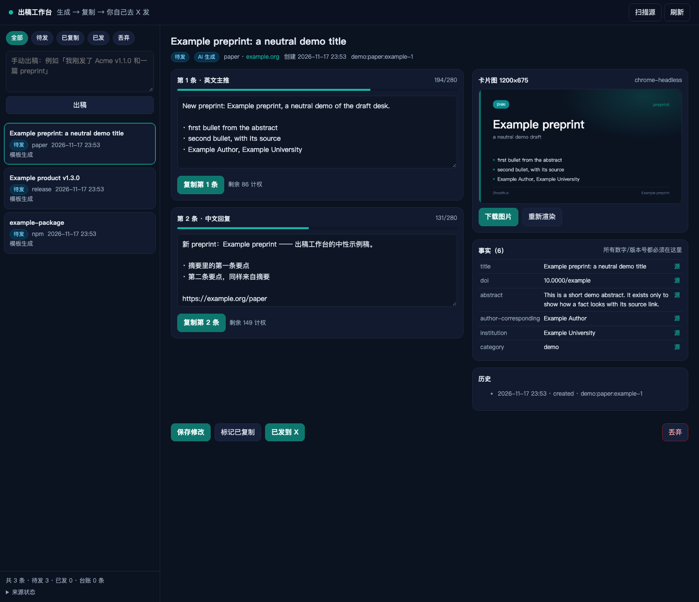
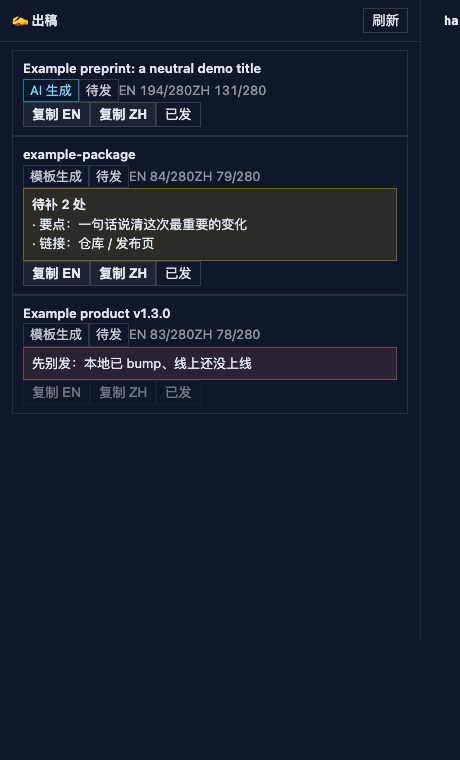

# dsh-post-draft-auto

**简体中文** · [English](#english)

不管是你自己发了东西（`我发了 X`），还是我刚替你做完一件事（`你给我做了 X，我要发个推`）——都能变成两条能直接粘进 X 的稿子 + 一张卡片图。
模型先用工具抓**带来源的真实事实**，再自己写中英双语；**发布永远是你手动复制粘贴**。

**怎么用：在 DSH 里跟 agent 说一句「我刚发了 …」就行** —— 不用打开任何界面。它抓完事实、写完中英双语
会直接贴回会话；你复制去发，发完回来说一声，它把台账记上。

> 一句话：这不是发帖机器人。没有 X API、没有 token、没有定时发布——
> 它只做「发了什么 → 能直接粘的稿子 + 能点回源头的事实表」这一段，最后那一下留给你。

## 为什么不是「又一个发帖机器人」

| | 常见的自动发帖 bot | 本工具 `dsh-post-draft-auto` |
|---|---|---|
| 发布 | 调 X API 或浏览器自动化 | **零发布能力**：你自己复制粘贴，工具不碰登录态 |
| 凭据 | API key / token / cookie | 一个都不存，代码里没有凭据读写 |
| 文案 | 模板套壳，或让模型自由发挥 | 先抓事实（每条带 `sourceUrl`），正文只能引用事实 |
| 出错 | 已经发出去了 | 抽不到就写 `⟨待补：…⟩`，闸门会拦下「已发」 |
| 成本 | 按调用计费，还要维护 token | 零依赖（只用 Node 内置模块）、只读公开接口 |

## 30 秒上手

**主要方式是「对话」**：不用打开任何界面，入口就是你在会话里说一句话。

**① 跟 agent 说一句话（主要方式，推荐）** —— 装好插件后，agent 自己按 `post_facts → 写稿 → post_save` 走完，
把英文主推 + 中文回复贴回会话；你复制走、发完回来说一声，它用 `post_mark_posted` 把台账记上。
一次典型的输入输出长这样（DOI / 链接用占位符）：

| 谁 | 发生了什么 |
|---|---|
| 你说 | 两种都行：`我刚发了一篇 preprint，DOI 是 ⟨你的 DOI⟩`（发布型）／`你给我做的 ⟨插件/版本⟩ 上线了，我要发个推`（成果型） |
| agent 做 | `post_facts` 抓标题 / 日期 / 版本 / 作者 / 单位 / 摘要，**每条带 `sourceUrl`** → 自己写英文主推 + 中文回复 + 卡片文案 → `post_save` 落盘 |
| 你拿到 | 英文主推 + 中文回复（各自标计权字数，**超 280 会被拦**）+ 卡片图 + 能点回源头的事实表 |
| 你发完 | 回来说一声 → `post_mark_posted` 写进 `state/posted.jsonl` 台账 |

**面板和网页工作台是同一个仓库的两个视图，不是必须的**：只对话也能完整走完（出稿 → 复制 → 发 → 记台账）。

**② 侧栏「✍ 出稿」面板**（装插件 + 重启 DSH 后出现）：右侧栏页签，列草稿、每行复制 EN/ZH、标已发；
细节见下文「工作台与侧栏面板」。

**③ 网页工作台 / CLI**（不装插件也能用）—— 同一套实现：

```sh
npm start        # = node bin/serve.mjs → http://127.0.0.1:4789
node bin/post-tool.mjs post_facts --json '{"doi":"<your-doi>"}'
node bin/post-tool.mjs post_save  --file /tmp/draft.json     # {en, zh, card, facts, sourceKey}
node bin/post-tool.mjs post_list
node bin/post-tool.mjs post_mark_posted --json '{"id":"<draft-id>"}'
```

不需要 `npm install`：没有任何依赖，Node ≥ 18 即可。

## 四种输入：`post_facts` 抓什么

| 你给的东西 | 调用 | 抓到的事实 |
|---|---|---|
| bioRxiv / medRxiv DOI | `{"doi":"<your-doi>"}` | 标题、DOI、日期、版本、全部作者、通讯作者、单位、分类、摘要全文 |
| 产品版本 | `{"version":"v1.2.3"}` | 线上版本、本地版本、`releases.md` 里这一版的要点（没有就退到 CHANGELOG 原话） |
| npm 包 | `{"pkg":"@deepseek-ai/dsh"}` | 版本、发布时间、包描述 |
| 任意 URL | `{"url":"https://…"}` | 页面标题、meta description、URL 本身 |
| 只有一句话 | `{"text":"我刚发了 Acme v1.1.0 和一篇 preprint"}` | 你口述的原话 + 抽出来的版本号 |

两个实测踩出来的细节：

- **bioRxiv 换过 DOI 前缀**：拿旧前缀查不到时，工具会自己换当前前缀再试一次（反过来也试），不用你改链接。
- **每条 fact 都带 `sourceUrl`**：`post_facts` 回来的 `facts[]` 里逐条能点回源头；作者名要用 `meta.authorInPaper` 里的写法，不要自己拼。

## 四个工具

插件（`lib/plugin.mjs`）和 CLI（`bin/post-tool.mjs`）共用 `lib/tools.mjs` 一份实现：

| 工具 | 作用 | 关键参数 | 返回 |
|---|---|---|---|
| `post_facts` | 抓事实，写稿前必须先调 | `doi` / `version` / `pkg` / `url` / `text`，可选 `server`、`author` | `kind`、`sourceKey`、`title`、`facts[]`（带 `sourceUrl`）、`hints[]`、`guard` |
| `post_save` | 把模型写好的稿落盘（`generatedBy: model`） | 必填 `en`、`zh`、`facts`；可选 `sourceKey`、`card{title,subtitle,version,bullets}`、`pending`、`notes` | `draftId`、`enWeight`、`zhWeight`、`pending`、`blockers`、`file` |
| `post_list` | 列草稿 | 可选 `status` | `total`、`drafts[]`（含 `generatedBy` / 计权 / 待补 / guard） |
| `post_mark_posted` | 你在 X 发完回来登记 | `id`，可选 `note`（比如 X 链接） | `ok`、`status`、`publishedAt`；被 guard 挡住时 `ok:false` |

两处硬拦截：**`post_save` 没带 `facts` 直接拒**（防凭空写）；**正文里的数字不在 facts 里就进 `blockers`**（防编）。

## 工作台与侧栏面板



上图是真实截图（一条 preprint 的草稿打在工作台里；草稿内容是演示用的中性示例，下同）：

- **左栏**：草稿列表，按 待发 / 已复制 / 已发 / 丢弃 筛选；每张卡片标来源（paper / npm / site / manual）、时间和「AI 生成 / 模板生成」徽标；底部是总数、台账条数和来源开关
- **右栏**：第 1 条英文主推 + 第 2 条中文回复，各自带实时计权（上图 194/280、131/280）和**独立复制按钮**（复制走服务端去 markdown，粘到 X 里是纯文本）
- **卡片图**：1200×675，有本机 Chrome 就出 PNG（`chrome-headless`），可下载/重新渲染；没有 Chrome 只出 SVG
- **事实表**：正文里每个版本号/日期/摘要都能点回 `sourceUrl`；**待补清单**单列，抽不到的信息显示成 `⟨待补：…⟩`
- **底部动作**：保存修改 / 标记已复制 / **已发到 X**（写台账，只追加）

**侧栏「✍ 出稿」面板**（v0.3.0 起随插件提供）—— 不开网页工作台也能看草稿：



（面板要重启 DSH 才出现在侧栏里；上面这张是用同一份 `lib/client.js` 在 harness 页里渲染的，见 [docs/侧栏面板.md](https://github.com/lanechenhku/dsh-post-draft-auto/blob/main/docs/%E4%BE%A7%E6%A0%8F%E9%9D%A2%E6%9D%BF.md)。）

- 位置：**右侧栏的页签选择器**里，名字「✍ 出稿」；装好（或更新）插件后要**完全退出 DSH（⌘Q）再启动**才会出现，客户端半部分在启动时加载
- 每张草稿卡片：标题、`AI 生成 / 模板生成`、状态、`EN n/280 · ZH n/280`（超了变红）、guard 红条、待补前 4 条
- 三个按钮：**复制 EN**、**复制 ZH**（都是服务端去过 markdown 的纯文本；剪贴板被拒时退化成选中文本，按 ⌘C）、**已发**（写台账；已发或被 guard 挡住时禁用）
- **面板是只读视图**：改文案、重新出稿仍走网页工作台或让 agent 重写；面板不提供编辑 / 删除 / 重新渲染
- 数据走宿主半部分注册的同源接口 `GET /post-draft/list`、`GET /post-draft/copy`、`POST /post-draft/mark-posted`，**不依赖 4789 那个进程**（网页工作台不开也能用）

## 硬性约束

### 不编数字

- 正文里出现的版本号、日期、百分数、作者名，必须来自 `post_facts` 返回的 `facts`（每条带 `sourceUrl`）
- 抽不到 → 写 `⟨待补：…⟩` 并进 `pending`，不会替你猜
- 正文里出现 facts 没有的数字 → `blockers` 非空，网页顶部标红

### 280 计权字符（没有 X Premium）

| 字符 | 权重 |
|---|---|
| 基本拉丁、数字、标点 | 1 |
| 中文 / 日文 / 韩文 / emoji | 2 |
| URL（不管多长） | 固定 23 |

所以**一条纯中文最多约 140 字**。工作台实时算，超了变红；`post_save` 也会把 `enWeight` / `zhWeight` 一起返回。

### 语气

`voice.md` 是写稿时的语气约定，禁用词在 `config.json.voice.banned`

**本机私有覆盖层**：把真实端点、本地仓库路径这类不该公开的值写进 `config.local.json`（已在 `.gitignore` 里），
它会被深合并到 `config.json` 之上；仓库里只保留占位符版本。键名与合并规则见 [config.local.example.json](https://github.com/lanechenhku/dsh-post-draft-auto/blob/main/config.local.example.json)：
对象深合并；对象数组按 index 深合并（所以只写要改的字段就行）；含原始值的数组整体替换；想换掉整个对象数组用 `{"$replace": [...]}`。
（`excited to announce`、`game-changer`、`revolutionary`、`震撼发布`… 以及中文的「重磅」「颠覆」「史上最强」）。
`voice.md` 现在还是默认的「零形容词」风格——你贴 3–5 条旧推，它就会变成你的语气。

## 守卫与状态机

**Acme 双源守卫**：线上 `https://example.com/version.json` 和本地 `<path-to-your-product-repo>/version.json`（只读）必须相等，否则：

| 情况 | guard | 后果 |
|---|---|---|
| 本地新、线上旧 | `pending-rollout` | 部署还没上线，先别发 |
| 线上新、本地旧 | `online-newer` | 查错了仓库/分支 |
| 本地读不到 | `local-missing` | 本地文件路径不对 |

被 guard 的草稿：**复制和「已发」都是 409**，界面顶部红字、按钮禁用；下次扫描两侧相等时自动解除。

**状态机**（一个 `source_key` 只允许一份草稿）：

```
discovered → drafted → copied → published
                  ↘ discarded
```

`published` 和 `discarded` 是终态；「已发」会把正文、计权、文本哈希追加进 `state/posted.jsonl`，重复点不会写第二条。

## 隐私与安全

- **全本地**：草稿、卡片图、状态、台账都在本机 `drafts/` `media/` `state/`，没有云端、没有账号、没有同步
- **不存凭据**：没有 token、没有 cookie、没有 `.env` 读取逻辑——「自动发布」这件事在代码层面不成立
- **网络只有只读公开接口**：你显式调用的 `post_facts` 才会去 npm registry、`api.biorxiv.org`、`example.com/version.json` 或你给的 `url` 取一次；GitHub Releases 源默认关闭（私有仓库未认证会 404，要开得加 token，本工具不当凭据容器）
- **只绑 `127.0.0.1`，但没有鉴权**：网页工作台自己起在 4789；侧栏面板的三个接口挂在 DSH 宿主自己的 webServer 上
  （和 GUI 同源，不新开端口）。两处都没有登录校验——能碰到 DSH GUI 或 4789 的人都能读草稿、点「已发」，别把它们暴露到公网
- **草稿不会误提交**：`drafts/`、`media/`、`state/` 都在 `.gitignore` 里（里面有未发布内容）

## 安装

### 作为 DSH 插件（desktop profile）

desktop profile 由 Electron 独占，**不能用 `dsh plugin --profile desktop ...`**（命令行会被无条件拒绝）。手工装：

1. `~/.dsh/profiles/desktop/package.json` 的 `dependencies` 加
   `"dsh-post-draft-auto": "link:<你 clone 的路径>"`
2. 同一个文件的 `dsh.profile.bundles` 数组追加 `"dsh-post-draft-auto"`
3. `~/.dsh/profiles/desktop/node_modules/dsh-post-draft-auto` 建符号链接指向仓库
4. **完全退出 DSH（⌘Q）再启动**

只加依赖、不加 `dsh.profile.bundles` 不会加载——DSH 只从 bundles 层挂载插件。
插件做三件事：**注册四个工具**、**往系统提示里加一段「怎么用这些工具写稿」的公告**、**给右侧栏加「✍ 出稿」页签**
（数据来自宿主上的三个 `/post-draft/*` 同源接口）。装或更新后必须**完全退出 DSH 再启动**，否则浏览器半部分不会加载。
装法就是把本仓库以 `link:` 依赖加进 DSH profile 的 `package.json`，再把这个包名写进 `dsh.profile.bundles`，重启 DSH 即生效（回滚：还原那份 `package.json` 备份后再重启）。

### 不装插件（npm 包或源码都行）

```sh
npm i -g dsh-post-draft-auto   # 也可以 npx dsh-post-draft-auto
post-draft-auto                # 启动网页工作台 → http://127.0.0.1:4789
post-draft-tool post_list      # 四个工具的 CLI（post_facts / post_save / post_list / post_mark_posted）
post-draft --help              # 出稿 CLI（--manual / --source / --collect / --mock）
```

在仓库里跑则等价于 `npm start`、`node bin/post-tool.mjs ...`、`node bin/draft.mjs ...`。
技能：把 [skills/post-draft/SKILL.md](https://github.com/lanechenhku/dsh-post-draft-auto/blob/main/skills/post-draft/SKILL.md) 拷到 `~/.dsh/skills/`，任何会话都能按同一流程出稿。

## 配置

`config.json` 关键字段：

| 字段 | 现在是什么 | 说明 |
|---|---|---|
| `port` | 4789 | 工作台端口，只绑 `127.0.0.1` |
| `brand` | Acme，`#0d8b8f` | 卡片图配色；主色是从 example.com 的 CSS 变量抽出来的 |
| `limits` | `tweet: 280`、`urlWeight: 23` | 计权规则 |
| `authorName` | `<你的英文署名>` | 占位符：不填就跳过作者匹配并提示「待补 author」，不会拉全量再猜 |
| `sources` | npm / github / jsonapi / rss / arxiv / site | 采集器的源开关；只有 `npm` 默认开。`site`（线上端点 + 本地版本文件双源）要你填好 url 与 local.file 再打开 |
| `releaseNotesFiles` | `docs/releases.md` → `<path-to-your-product-repo>/docs/releases.md` | 按顺序找这一版的要点 |
| `voice` | 7 个禁用词、hashtag ≤ 2 | 语气检查 |

`voice.md` 是语气正文：结构固定为「发布体 → 2–3 条要点 → 入口」，外加一条「不承诺路线图」。

## 数据

```
drafts/<id>.json     一条草稿（正文、计权、facts、pending、blockers、history）
media/<id>.svg|.png  卡片图（1200×675）
state/events.json    幂等状态机（source_key → 状态）
state/posted.jsonl   已发台账（只追加，不改不删）
```

普通 JSON，原子写入；`drafts/` `media/` `state/` 都不进版本库。

## 测试与验收

```sh
npm test        # = node --test tests/
```

当前 **66/66 通过**，覆盖：计权（CJK / URL / emoji / 截断 / 切分）、溯源拦截、占位符、禁用词、
同 `source_key` 幂等、状态机终态、台账只写一次、复制文本无 markdown、发布闸门 409、
插件契约（`name` / `inject` / `apply` 真注册四个工具），以及侧栏面板（client 模块契约、
宿主接口 list / copy / mark-posted 与 guard 409）。

一次真实端到端（本机）：

| 环节 | 结果 |
|---|---|
| 输入 | 一句话：`我刚发了一篇 preprint，DOI 是 ⟨你的 DOI⟩` |
| `post_facts` | 返回标题 / 日期 / 版本 / 作者 / 单位 / 摘要等十余条 facts，每条带 `sourceUrl`；旧 DOI 前缀查不到时会自动换前缀重试一次 |
| `post_save` | 落盘一条草稿，EN / ZH 都落在 280 计权以内，`blockers` 0、`pending` 0 |
| 复制文本 | `GET /api/drafts/<draft-id>/copy?part=en` 返回的就是正文，markdown 符号 0 个 |
| 核对 | 正文里出现的每个数字 / 日期 / 作者名都能指回 facts |

## 已知限制

- **语气要你自己校准**：`voice.md` 没贴过旧推，现在偏「零形容词」；给它 3–5 条旧推才会像你说话
- **中文不是机器翻译**：ZH 那条要么模型据事实写，要么你自己写；缺了就显示 `⟨待补：中文要点一句话⟩`
- **功能点依赖 `releases.md`**：那一版没有条目就退到 CHANGELOG 原话，两处都没有 → 待补，不编
- **npm 源没有 changelog**：只能给版本号 / 日期 / 描述，要点要人补
- **GitHub Releases 源默认关闭**：私有仓库未认证会 404，要开得加 token——本工具不当凭据容器，所以默认关
- **卡片 PNG 依赖本机 Chrome**：找不到 Chrome/Chromium 就只出 SVG（可在浏览器另存）
- **工作台没有鉴权**：只绑 `127.0.0.1`，同机进程能读草稿，别把端口暴露到公网
- **侧栏面板是只读视图**：改文案、重新出稿、重新渲染卡片仍走网页工作台或让 agent 重来；
  面板不能编辑/删除草稿，也不显示卡片大图（只有列表和两个复制按钮）

## 相关文档

- [docs/侧栏面板.md](https://github.com/lanechenhku/dsh-post-draft-auto/blob/main/docs/%E4%BE%A7%E6%A0%8F%E9%9D%A2%E6%9D%BF.md) —— 侧栏「出稿」面板的接线方式、验证步骤
- [docs/releases.md](https://github.com/lanechenhku/dsh-post-draft-auto/blob/main/docs/releases.md) —— 发布说明的写法（功能点只从这里取）
- [skills/post-draft/SKILL.md](https://github.com/lanechenhku/dsh-post-draft-auto/blob/main/skills/post-draft/SKILL.md) —— 「我发了 X」触发的那套流程
- [voice.md](https://github.com/lanechenhku/dsh-post-draft-auto/blob/main/voice.md) —— 语气约束
- [docs/github-meta.md](https://github.com/lanechenhku/dsh-post-draft-auto/blob/main/docs/github-meta.md) —— 仓库门面（description / topics / release）的取值与理由
- [CHANGELOG.md](https://github.com/lanechenhku/dsh-post-draft-auto/blob/main/CHANGELOG.md) —— 版本历史（0.1.0 → 0.3.4）与 [LICENSE](https://github.com/lanechenhku/dsh-post-draft-auto/blob/main/LICENSE)

## License

[MIT](https://github.com/lanechenhku/dsh-post-draft-auto/blob/main/LICENSE) © 2026 Lane Guolan Chen

零依赖、不发推、不存凭据；修改、商用、再分发都按 MIT 来，保留版权与许可声明即可。
仓库根目录的 [LICENSE](https://github.com/lanechenhku/dsh-post-draft-auto/blob/main/LICENSE) 是纯文本 MIT，GitHub 会据此显示许可证。

---

<a id="english"></a>

# dsh-post-draft-auto (English)

Whether you shipped something yourself ("I just shipped X") or the agent just built it for you ("you made me X, I want to post about it"), it turns into two posts you can paste straight into X, plus a card image.
The model first pulls **real facts with sources**, then writes EN + ZH itself — **you still publish by hand**.

**How to use it: open DSH and tell the agent "I just shipped …"** — no UI to open. It pulls the facts, writes
both posts and hands them back in the conversation; you copy them into X, say so afterwards, and it records
the ledger entry.

> In one line: this is not a posting bot. No X API, no tokens, no scheduling.
> It covers exactly one stretch — "what shipped → paste-ready drafts + a fact table you can click back to the
> source" — and leaves the publish button to you.

## Why it is not another posting bot

| | A typical posting bot | `dsh-post-draft-auto` |
|---|---|---|
| Publishing | Calls the X API or automates a browser | **Zero publishing capability**: you copy and paste; it never touches a session |
| Credentials | API key / token / cookie | None stored; there is no credential handling in the code |
| Copy | Template shells, or the model free-styling | Facts first (each with a `sourceUrl`); the body may only quote them |
| Failure mode | Already posted | Writes `⟨todo: …⟩` instead, and the gate blocks "posted" |
| Cost | Per-call billing plus token upkeep | Zero dependencies (Node built-ins only), read-only public endpoints |

## Quick start

**The main way is the conversation**: there is no UI to open — you say one sentence in the session.

**① Talk to the agent (main way, recommended)** — with the plugin installed the agent runs
`post_facts → write → post_save` on its own and hands the English post and the Chinese reply back in the
conversation. You copy, publish, come back and say so, and it records the ledger through `post_mark_posted`.
A typical input and output looks like this (DOI / link are placeholders):

| Who | What happened |
|---|---|
| You | `我刚发了一篇 preprint，DOI 是 ⟨your DOI⟩` (or: `链接 https://…`) |
| The agent | `post_facts` pulls title / date / version / authors / institution / abstract, **each with a `sourceUrl`** → writes the English post, the Chinese reply and the card copy → `post_save` saves the draft |
| You got | English post + Chinese reply (each with its weighted count, **over 280 is blocked**) + the card image + a fact table that links back to the source |
| After posting | you say so → `post_mark_posted` appends to `state/posted.jsonl` |

**The panel and the web workbench are two views of the same repository, not a requirement**: the conversation
alone covers the whole loop (draft → copy → publish → ledger).

**② Sidebar "✍ 出稿" panel** (appears after installing the plugin and restarting DSH): a right-sidebar tab
that lists drafts with per-row copy EN / copy ZH and a posted button — see "Workbench and sidebar panel" below.

**③ Web workbench and CLI** (both work without the plugin):

```sh
npm start        # = node bin/serve.mjs → http://127.0.0.1:4789
node bin/post-tool.mjs post_facts --json '{"doi":"<your-doi>"}'
node bin/post-tool.mjs post_save  --file /tmp/draft.json     # {en, zh, card, facts, sourceKey}
node bin/post-tool.mjs post_list
node bin/post-tool.mjs post_mark_posted --json '{"id":"<draft-id>"}'
```

No `npm install` needed: there are no dependencies. Node ≥ 18 is enough.

## What `post_facts` pulls

| You give | Call | Facts you get back |
|---|---|---|
| bioRxiv / medRxiv DOI | `{"doi":"<your-doi>"}` | Title, DOI, date, version, authors, corresponding author, institution, category, full abstract |
| A product version | `{"version":"v1.2.3"}` | Online version, local version, this version's notes from `releases.md` (falls back to CHANGELOG quotes) |
| An npm package | `{"pkg":"@deepseek-ai/dsh"}` | Version, publish date, package description |
| Any URL | `{"url":"https://…"}` | Page title, meta description, the URL itself |
| Just one sentence | `{"text":"I just shipped Acme v1.1.0 and a preprint"}` | Your sentence plus any version numbers in it |

Two details learned the hard way:

- **bioRxiv has changed its DOI prefix**: when the old prefix finds nothing, the tool retries with the current
  one (and the other way round) — you do not have to fix the link.
- **Every fact carries a `sourceUrl`**: each entry in `facts[]` links back to its origin; use the spelling from
  `meta.authorInPaper` when you print an author name.

## The four tools

The plugin (`lib/plugin.mjs`) and the CLI (`bin/post-tool.mjs`) share one implementation, `lib/tools.mjs`:

| Tool | Purpose | Key arguments | Returns |
|---|---|---|---|
| `post_facts` | Gather facts; always call before writing | `doi` / `version` / `pkg` / `url` / `text`, optional `server`, `author` | `kind`, `sourceKey`, `title`, `facts[]` (with `sourceUrl`), `hints[]`, `guard` |
| `post_save` | Save the model-written draft (`generatedBy: model`) | required `en`, `zh`, `facts`; optional `sourceKey`, `card{title,subtitle,version,bullets}`, `pending`, `notes` | `draftId`, `enWeight`, `zhWeight`, `pending`, `blockers`, `file` |
| `post_list` | List drafts | optional `status` | `total`, `drafts[]` (`generatedBy` / weights / pending / guard) |
| `post_mark_posted` | Record it after you posted on X | `id`, optional `note` (e.g. the X URL) | `ok`, `status`, `publishedAt`; `ok:false` when a guard blocks it |

Two hard stops: **`post_save` rejects a call without `facts`** (no writing from thin air), and **any number in the
body that is not in the facts lands in `blockers`** (no invented figures).

## Workbench and sidebar panel


The screenshot above is real (a preprint draft open in the workbench; the draft content is a neutral demo, same below):

- **Left**: the draft list filtered by drafted / copied / published / discarded; each card shows source
  (paper / npm / site / manual), time and an "AI generated / template" badge; the footer shows totals, ledger
  rows and source switches
- **Right**: post 1 (English main) and post 2 (Chinese reply), each with live weighted counts (194/280 and
  131/280 above) and **its own copy button** (copy goes through the server's markdown stripper, so what you
  paste into X is plain text)
- **Card**: 1200×675; a local Chrome produces the PNG (`chrome-headless`), downloadable and re-renderable;
  without Chrome you only get the SVG
- **Fact table**: every version, date and abstract sentence links back to its `sourceUrl`; a separate
  **to-fill list** shows anything that could not be sourced as `⟨todo: …⟩`
- **Bottom actions**: save edits / mark copied / **posted to X** (appends to the ledger)

**Sidebar "✍ 出稿" panel** (shipped with the plugin since v0.3.0) — the draft list without opening the web
workbench:


(The tab only appears after restarting DSH; the image above renders the same `lib/client.js` in a harness page — see [docs/侧栏面板.md](https://github.com/lanechenhku/dsh-post-draft-auto/blob/main/docs/%E4%BE%A7%E6%A0%8F%E9%9D%A2%E6%9D%BF.md).)

- Where: in the **right sidebar's tab picker**, named "✍ 出稿". After installing or updating the plugin you must
  **quit DSH completely (⌘Q) and start it again** — the client half loads at startup
- Each draft card shows: title, `AI generated / template`, status, `EN n/280 · ZH n/280` (red over the limit),
  a red guard banner, and the first four to-fill items
- Three buttons per row: **copy EN**, **copy ZH** (plain text, markdown already stripped server-side; if the
  clipboard is refused it selects the text and asks you to press ⌘C), and **posted** (writes the ledger;
  disabled once published or while guarded)
- **The panel is a read-only view**: editing copy or re-drafting still means the web workbench or asking the
  agent; it offers no edit / delete / re-render
- Data comes from three same-origin routes the host half registers — `GET /post-draft/list`,
  `GET /post-draft/copy`, `POST /post-draft/mark-posted` — and **does not depend on the 4789 process**
  (the panel works with the web workbench closed)

## Hard rules

### No invented numbers

- Versions, dates, percentages and author names in the body must come from the `facts` returned by
  `post_facts` (each with a `sourceUrl`)
- Missing information becomes `⟨todo: …⟩` plus a `pending` entry — never a guess
- A number in the body that is not in the facts makes `blockers` non-empty and marks the draft red

### 280 weighted characters (no X Premium)

| Characters | Weight |
|---|---|
| Basic Latin, digits, punctuation | 1 |
| CJK, emoji | 2 |
| URLs (however long) | a flat 23 |

So **a purely Chinese post tops out around 140 characters**. The workbench recomputes it live and turns red
when you go over; `post_save` returns `enWeight` / `zhWeight` too.

### Tone

`voice.md` holds the tone contract; the banned phrases live in `config.json.voice.banned`

**Local override**: keep real endpoints and local repo paths in `config.local.json` (already in `.gitignore`). It is
deep-merged on top of `config.json`; the repository only carries the placeholder version. Key names and merge rules are in
[config.local.example.json](https://github.com/lanechenhku/dsh-post-draft-auto/blob/main/config.local.example.json): objects merge deeply, arrays of objects merge by index (so you can
override just one field), arrays of primitives replace wholesale, and `{"$replace": [...]}` replaces an object array outright.
(`excited to announce`, `game-changer`, "重磅", "颠覆", "史上最强"…). It is still the conservative default —
hand it 3–5 of your old posts and it will sound like you.

## Guards and state machine

**Acme two-source guard**: `https://example.com/version.json` and the local
`<path-to-your-product-repo>/version.json` (read-only) must agree, otherwise:

| Situation | Guard | Consequence |
|---|---|---|
| Local newer, online older | `pending-rollout` | The deploy has not landed; hold the post |
| Online newer, local older | `online-newer` | Wrong repo or branch |
| Local file unreadable | `local-missing` | Wrong local path |

A guarded draft returns **409 for both copy and "posted"**, shows a red banner and disables the buttons; the
next scan that finds both sides equal lifts it automatically.

**State machine** (one draft per `source_key`):

```
discovered → drafted → copied → published
                  ↘ discarded
```

`published` and `discarded` are terminal; "posted" appends the body, weight and text hash to
`state/posted.jsonl`, and clicking twice does not write a second row.

## Privacy and security

- **All local**: drafts, cards, state and the ledger live in `drafts/` `media/` `state/` on this machine — no cloud,
  no account, no sync
- **No credentials**: no tokens, no cookies, no `.env` handling — "auto-posting" simply cannot be built out of this code
- **Network access is read-only and public**: only an explicit `post_facts` call reaches the npm registry,
  `api.biorxiv.org`, `example.com/version.json` or the `url` you supplied. The GitHub Releases source is off by
  default (a private repo 404s without a token, and this tool is not a credential store)
- **Binds `127.0.0.1` only, and has no auth**: the web workbench listens on 4789, and the panel's three routes
  ride the DSH host's own server (same origin as the GUI, no extra port). Neither has a login: anyone who can
  reach the GUI or 4789 can read drafts and mark them posted — keep both off the internet
- **Drafts cannot be committed by accident**: `drafts/`, `media/` and `state/` are in `.gitignore` (they hold
  unpublished content)

## Install

### As a DSH plugin (desktop profile)

The desktop profile belongs exclusively to Electron, so **`dsh plugin --profile desktop ...` is refused**
unconditionally. Install by hand:

1. Add `"dsh-post-draft-auto": "link:<your clone path>"` to `dependencies` in
   `~/.dsh/profiles/desktop/package.json`
2. Append `"dsh-post-draft-auto"` to the `dsh.profile.bundles` array in the same file
3. Symlink `~/.dsh/profiles/desktop/node_modules/dsh-post-draft-auto` to the repository
4. **Quit DSH completely (⌘Q) and start it again**

The dependency alone does not load the plugin — DSH only mounts what is in the bundles layer. The plugin does
three things: **registers the four tools**, **adds a short "how to use these tools when drafting" notice to the
system prompt**, and **adds the "✍ 出稿" tab to the right sidebar** (fed by three same-origin `/post-draft/*`
routes on the host). Quit DSH completely after installing or updating, otherwise the client half will not load.
To install, add this repo as a `link:` dependency in the DSH profile `package.json`, add the package name to `dsh.profile.bundles`, and restart DSH (rollback: restore that `package.json` backup, then restart).

### Without the plugin (npm package or the source tree)

```sh
npm i -g dsh-post-draft-auto   # or: npx dsh-post-draft-auto
post-draft-auto                # start the web workbench → http://127.0.0.1:4789
post-draft-tool post_list      # CLI for the four tools (post_facts / post_save / post_list / post_mark_posted)
post-draft --help              # drafting CLI (--manual / --source / --collect / --mock)
```

From the repository the same things are `npm start`, `node bin/post-tool.mjs ...` and `node bin/draft.mjs ...`.
Skill: copy [skills/post-draft/SKILL.md](https://github.com/lanechenhku/dsh-post-draft-auto/blob/main/skills/post-draft/SKILL.md) into `~/.dsh/skills/` so any session
follows the same flow.

## Configuration

Key fields in `config.json`:

| Field | Current value | Meaning |
|---|---|---|
| `port` | 4789 | Workbench port, bound to `127.0.0.1` only |
| `brand` | Acme, `#0d8b8f` | Card colours; the primary was extracted from example.com's CSS variables |
| `limits` | `tweet: 280`, `urlWeight: 23` | Weighting rules |
| `authorName` | `<your name as printed>` | A placeholder: left unset, author matching is skipped with a "needs author" note instead of guessing |
| `sources` | npm / github / jsonapi / rss / arxiv / site | Collector source switches; only `npm` is on by default. `site` (online endpoint + local version file) needs your url and local.file before you enable it |
| `releaseNotesFiles` | `docs/releases.md` → `<path-to-your-product-repo>/docs/releases.md` | Where this version's notes are looked up, in order |
| `voice` | 7 banned phrases, hashtags ≤ 2 | Tone checks |

`voice.md` is the tone body: "release line → 2–3 bullets → where to get it", plus "do not promise a roadmap".

## Data

```
drafts/<id>.json     one draft (body, weights, facts, pending, blockers, history)
media/<id>.svg|.png  the card (1200×675)
state/events.json    idempotent state machine (source_key → state)
state/posted.jsonl   posted ledger (append-only)
```

Plain JSON, written atomically; none of `drafts/` `media/` `state/` is tracked by git.

## Tests and verification

```sh
npm test        # = node --test tests/
```

**66/66 passing** right now, covering: weighting (CJK / URL / emoji / truncation / splitting), source-gate
blocking, placeholders, banned phrases, idempotency per `source_key`, terminal states, append-only ledger,
markdown-free copy text, the 409 publish gate, the plugin contract (`name` / `inject` / `apply` really
registering the four tools), and the sidebar panel (client module contract, host routes list / copy /
mark-posted, guard 409).

A real end-to-end run (on this machine):

| Step | Result |
|---|---|
| Input | One sentence: `我刚发了一篇 preprint，DOI 是 ⟨your DOI⟩` |
| `post_facts` | Returns title / date / version / authors / institution / abstract as a dozen facts, each with a `sourceUrl`; an old DOI prefix that finds nothing is retried with the current one |
| `post_save` | Saves one draft with both EN and ZH under the 280 weighted limit, 0 blockers, 0 pending |
| Copy text | `GET /api/drafts/<draft-id>/copy?part=en` returns the body verbatim with zero markdown characters |
| Audit | Every number, date and author name in the body traces back to facts |

## Known limitations

- **The tone is yours to calibrate**: `voice.md` has no sample posts yet, so it is deliberately adjective-free
- **Chinese is not machine-translated**: the ZH post is either written from the facts by the model or by you;
  when it is missing you get `⟨todo: one-line Chinese summary⟩`
- **Feature bullets depend on `releases.md`**: without an entry it falls back to CHANGELOG quotes; with neither it
  stays "to fill" rather than invented
- **The npm source has no changelog**: version, date and description only — bullets are for you to add
- **The GitHub Releases source is off by default**: a private repo 404s without a token, and this tool refuses to
  be a credential store
- **The card PNG needs a local Chrome**: without Chrome/Chromium you only get the SVG (save-as works)
- **The workbench has no auth**: it binds `127.0.0.1`, so same-machine processes can read drafts — keep the port
  off the internet
- **The sidebar panel is a read-only view**: editing copy, re-drafting or re-rendering the card still
  means the workbench or the agent; the panel cannot edit or delete drafts and shows no card image

## License

[MIT](https://github.com/lanechenhku/dsh-post-draft-auto/blob/main/LICENSE) © 2026 Lane Guolan Chen

Use, modify and redistribute it under the MIT terms; keep the copyright and permission notice.
The plain-text [LICENSE](https://github.com/lanechenhku/dsh-post-draft-auto/blob/main/LICENSE) in the repository root is what GitHub reads for the licence badge.
