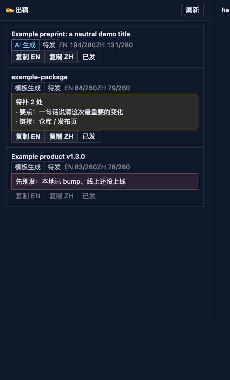

# DSH 侧栏「✍ 出稿」面板（v0.3.0）

一句话：DSH 右侧栏多一个「出稿」页签，列出所有草稿，每行两个复制按钮 + 一个「已发」，**不用再打开 4789 网页**。

## 一、它是怎么接上的（照 dsh-claude-project-ui 的结构做）

| 位置 | 作用 |
|---|---|
| `package.json` → `dsh.client = { platform: "web", inject: [...] }`、`exports["./client"] = "./lib/client.js"` | 告诉 DSH 这个包有浏览器半部分 |
| `lib/client.js` | 浏览器半部分：`window.__ModuleLoader__.load(...)` 里用 `sidebarRightTabs.register` 注册页签，用 `slots.inject("sidebar.right.pane.tab")` 挂面板 |
| `lib/web-api.mjs` | 宿主半部分：用 `ctx.webServer.register({ kind: "exact", path, handler })` 注册三个接口 |
| `lib/plugin.mjs` | `inject: ["tools","systemPrompt","webServer"]`，`ctx.effect` 里注册路由（卸载时自动摘掉） |

**没有构建步骤**：浏览器半部分就是一份普通 JS（`window.__ModuleLoader__` 包装，React 由 DSH 通过 `require("react")` 提供），和参照包一样直接把源码放进仓库，profile 的 `link:` 指向源码目录即可加载。所以不存在「构建产物没提交」的问题。

接口（同源，不占端口、不需要 `npm start`）：

- `GET /post-draft/list` → `{ ok, total, drafts: [...] }`（轻量字段：标题/状态/generatedBy/EN-ZH 计权/pending/guard，**不返回正文**）
- `GET /post-draft/copy?id=<draft>&part=en|zh` → `text/plain` 纯文本（复用 `lib/compose.mjs` 的 `copyText`，**去 markdown**）
- `POST /post-draft/mark-posted` `{ id }` → 复用 `post_mark_posted` 同一套台账逻辑，guard 生效时返回 409

## 二、面板上有什么

- 每张草稿卡：标题、`AI 生成 / 模板生成` 标签、状态（待发/已复制/已发）、`EN n/280` `ZH n/280`（超标变红）
- 行内按钮：**复制 EN**、**复制 ZH**、**已发**
- 「待补」用黄色块列出前 4 条，不藏
- guard（比如本地已 bump、线上还没上线）红块提示，同时禁用复制/已发
- 空列表：「还没有草稿 / 跟 agent 说『我刚发了 XXX』就会出稿」
- 顶部「刷新」，操作完自动刷新

复制失败时的降级顺序：`navigator.clipboard.writeText` → 临时 `textarea` + `execCommand("copy")` → 两者都失败则**保留选中**并提示「已选中文本，请按 ⌘C 复制」。

## 三、你只需要做一步：重启 DSH

⌘Q 完全退出「DeepSeek Harness」，再打开。然后：

1. 打开右侧栏 （右上角的侧栏按钮），在页签选择器里找 **✍ 出稿**
2. 里面应该列出真实草稿（标题、状态、「AI 生成 / 模板生成」标签、`EN n/280` `ZH n/280`）
3. 点「复制 EN」→ 到 X 的输入框 ⌘V，粘贴出来应该就是那段英文正文

**没出现页签时看这里**：`~/.dsh/profiles/desktop/node_modules/dsh-post-draft-auto` 是否还指向 `<path-to-this-repo>`；`package.json` 的 `dsh.profile.bundles` 里是否还有 `dsh-post-draft-auto`。回滚命令：`cp ~/.dsh/profiles/desktop/package.json.bak-20261118-064919 ~/.dsh/profiles/desktop/package.json`。

## 四、验证证据（不重启也能复现的做法）

侧栏要重启才出现，所以本轮用 **harness** 把同一份 `lib/client.js` 挂到真实浏览器里渲染：

- `docs/panel-harness.html`（由 `docs/build-harness.mjs` 生成：真实草稿数据 + 真实 client.js + 桩掉的三个接口）
- `node docs/shot.mjs` → 出 `docs/panel.png`，并自动点「复制 EN」，把**真正交给剪贴板的文本**写进 `docs/panel-copy.txt`
- 本次实测：`toast = "已复制 英文主推（clipboard）"`，`pasted` 就是该草稿的英文正文（无 `**`、无 ``）
- 单元测试：`tests/web-api.test.mjs`（三个接口 + guard 409 + 台账）、`tests/client-module.test.mjs`（页签注册 + 复制三条路径）

## 五、已知边界

- 面板是只读视图：改文案要么让 agent 重新出稿，要么用 4789 网页工作台；面板不做编辑。
- 面板与 4789 共用同一份 `data/`，两边看到的是同一批草稿。
- 浏览器若把页面当非安全上下文（极少见）会退到 textarea 路径，命令行里会提示。
